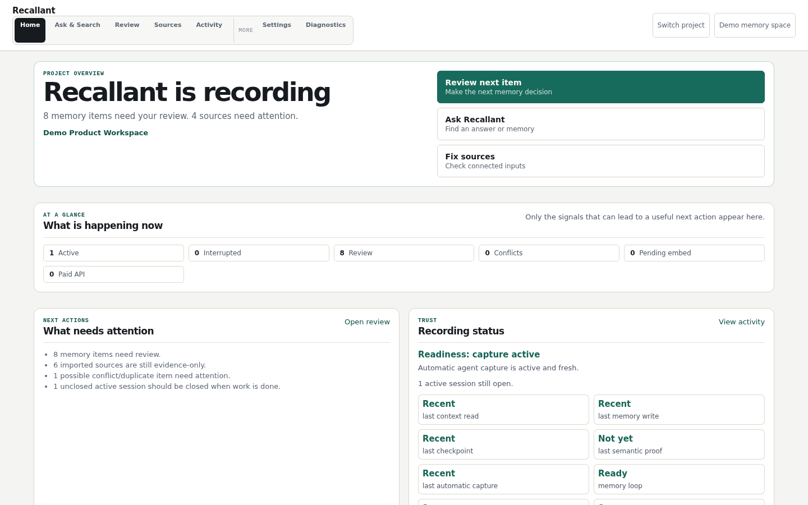
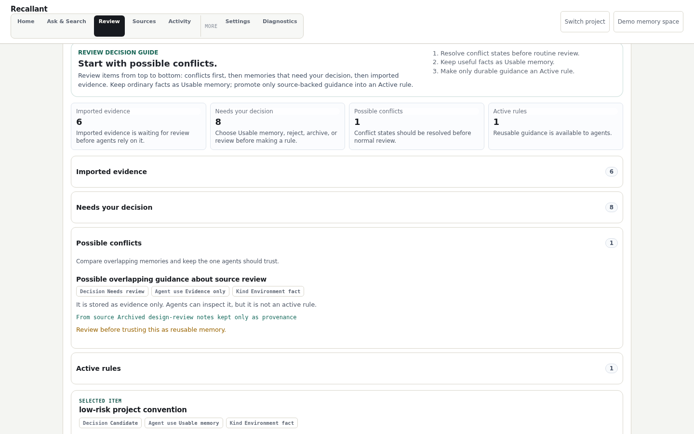
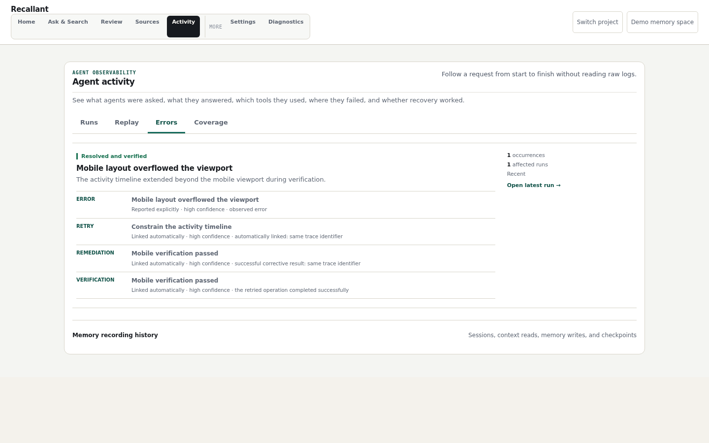
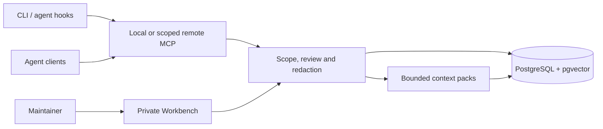

# Recallant

[](https://github.com/Mushkrot/Recallant/actions/workflows/ci.yml)
[](https://github.com/Mushkrot/Recallant/actions/workflows/codeql.yml)

**Self-hosted governed project memory for coding agents.**

Recallant helps an agent continue project work without asking a person to reconstruct the previous
chat. It stores decisions, evidence and session checkpoints, then returns a bounded context pack
for the next task. Each memory keeps its source, project scope and review state. A remembered
sentence does not automatically become an instruction.

Built with **TypeScript, PostgreSQL + pgvector, a CLI and MCP**, with a private browser Workbench
for reviewing memory and diagnosing capture. Recallant is a **development prerelease** for
single-owner evaluation and controlled use.

[Try it](#try-it) · [Architecture](docs/ARCHITECTURE.md) · [Current status](docs/STATUS.md) ·
[Changes](CHANGELOG.md) · [Contributing](CONTRIBUTING.md)

## What Ships Today

| Capability | What it provides |
| --- | --- |
| Session continuity | Each chat owns its checkpoint. Parallel chats cannot overwrite one another's recovery state; accepted project memories remain shareable. |
| Bounded retrieval | Context packs combine relevant memories, active rules and recovery state within a size budget, with explicit omissions. |
| Governed memory | Evidence, reusable memory and active rules have different authority. Source references and review decisions remain inspectable. |
| CLI and MCP | Local stdio and authenticated remote access share session, context, event and closeout operations. |
| Offline recovery | Events can spool locally and replay after reconnection, preserving session ownership and avoiding duplicate uploads. |
| Private Workbench | Review memories, inspect sources, search context and follow capture failures through retry and verification. |

## Try It

For a local self-hosted evaluation, follow the [Quickstart](docs/QUICKSTART.md). It explains Node.js,
Docker/PostgreSQL requirements, the install preview and rollback. The published tagged installation is:

```bash
curl -fsSL https://raw.githubusercontent.com/Mushkrot/Recallant/v0.1.0-dev.4/scripts/install-recallant-bootstrap.sh \
  | bash -s -- --ref v0.1.0-dev.4
recallant onboard /path/to/project
```

The `main` branch contains the continuity improvements described in the [changelog](CHANGELOG.md).
Use `--ref main` with the bootstrap installer to evaluate those changes; tagged installations remain
pinned until you deliberately change the selected ref.

For a workstation using an existing Recallant server:

```bash
recallant onboard /path/to/project --server-url https://memory.example.com
```

Onboarding uses local storage or a server supplied by project configuration, the deployment environment or `--server-url`. Without either route, it stops before changing project files.
Remote clients do not need a local PostgreSQL installation.

### Record a decision and recover it

After onboarding a disposable project, run:

```bash
recallant agent-start --project-dir /path/to/project --format json
recallant agent-event --project-dir /path/to/project --kind decision \
  --text "The demo exports reports as CSV."
recallant agent-closeout --project-dir /path/to/project \
  --summary "Recorded the CSV export decision." --format json
recallant agent-start --project-dir /path/to/project \
  --task-hint "Recover the CSV export decision" --format json
```

Inspect the closeout's memory and next-session readiness results. The last command returns a new
`session_id` and `context_pack_id`. For a local installation, read the actual context with:

```bash
recallant context --project-dir /path/to/project \
  --session-id <returned-session-id> --task-hint "Recover the CSV export decision"
```

For a remote connection, ask the configured MCP client to call `memory_get_context_pack` with that
`session_id` and task hint; the CLI `context` command requires local database access.
A saved checkpoint alone does not prove searchable memory. Review policy can hold a candidate;
context packs are bounded, so a successful write does not guarantee inclusion in every pack.
See [Client setup](docs/CLIENT_SETUP.md) for explicit session identities and targeted recall.

**Automatic Codex capture requires project-hook approval.** After approving Recallant's hook in
your client, perform a normal agent action and run
`recallant doctor --project-dir /path/to/project --require-capture`.
MCP access, memory-loop readiness and fresh automatic capture are reported separately.

## See It Working

The Workbench runs privately or behind authentication. These screenshots use deterministic
synthetic data from the [browser test fixture](docs/assets/workbench/README.md).



<details>
<summary>Review a memory and inspect a recovery chain</summary>

Review ties each proposed memory to its source and an explicit decision.



Activity connects a failure to retries, remediation and verification.



</details>

## The Memory Contract

1. **Evidence** records what happened or what an approved source contained. It is not a rule.
2. **Reusable memory** contains facts, decisions and lessons permitted for recall within their scope.
3. **Active rules** are durable guidance promoted through authorized review, with provenance.

A session checkpoint belongs to one chat. Project memory can be shared across chats, but recovery
must not guess that another chat's unfinished task is the current task. Context packs make that
boundary visible and leave deeper evidence available through search.



[Architecture](docs/ARCHITECTURE.md) explains identity, storage, retrieval, failure recovery and the
tradeoffs. For a code review, start with [contracts](packages/contracts/src),
[policy and redaction](packages/core/src), [MCP tools](packages/mcp/src/tools.ts),
[context selection](packages/db/src/context-pack.ts) and [migrations](packages/db/migrations).

## Engineering Evidence

CI checks formatting, lint, TypeScript builds, dependency advisories, public safety, database-backed
product scenarios and desktop/mobile browser behavior. CodeQL runs separately. The continuity
suite exercises parallel sessions, restart recovery, legacy migration, local and remote consumers,
offline replay and factual closeout through disposable databases.

```bash
npm ci
npm run build
npm run lint
npm run format:check
```

See [Contributing](CONTRIBUTING.md) for database-backed tests, the continuity suite and install
checks. Browser fixtures and deterministic embeddings make local checks reproducible; they do not
establish native client compatibility or production capacity by themselves.

## Current Scope and Limits

Native automatic capture is **Codex-first today**. Claude Code, Cursor, Windsurf and generic MCP
clients can use the shared service, but configuration does not prove equivalent native capture.
Real bidirectional Codex to Claude Code to Codex continuity remains unverified.

Recallant does not yet provide a general human document workspace, unrestricted folder crawling or
production-ready answers over arbitrary PDF/DOCX collections. It has no stable `1.0` compatibility
or team-wide support guarantee. Operators own deployment access, backups and capacity.

The [roadmap](docs/ROADMAP.md) describes four ordered milestones: Cross-Client Continuity,
Human Document Memory, a Task Handoff Record and broader sources. These are future directions,
not capabilities included by installing this repository.

## Documentation

- **Evaluate:** [Quickstart](docs/QUICKSTART.md), [Status](docs/STATUS.md),
  [Product contracts](docs/CONTRACT_STATUS.md), [Why Recallant](docs/WHY_RECALLANT.md).
- **Use and operate:** [Client setup](docs/CLIENT_SETUP.md),
  [Agent-ready projects](docs/AGENT_READY_PROJECTS.md), [Self-hosting](docs/SELF_HOSTING.md),
  [Runbook](docs/RUNBOOK.md), [Security](docs/SECURITY.md).
- **Explore:** [Documentation index](docs/README.md), [Domain language](CONTEXT.md),
  [Comparisons](docs/COMPARISON.md), [Research notes](docs/research/README.md).

## License

[Apache License 2.0](LICENSE).
